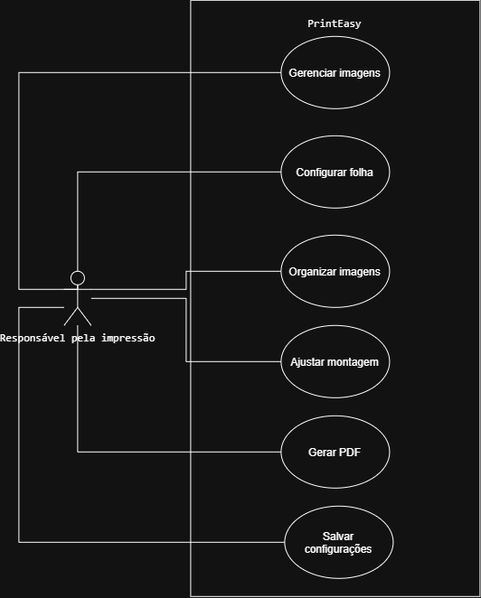

# 4.2.2 Modelagem de Casos de Uso

## Atores

| Ator | Quem é | O que faz no sistema |
|---|---|---|
| Responsável pela impressão | Pessoa responsável pela preparação das imagens para impressão. | Gerencia imagens, configura a folha, organiza e ajusta a montagem, gera PDFs e salva configurações. |

## Casos de uso

| Caso de uso | Ator | Atende |
|---|---|---|
| Gerenciar imagens | Responsável pela impressão | RF01 |
| Configurar folha | Responsável pela impressão | RF02 e RF03 |
| Organizar imagens | Responsável pela impressão | RF04 |
| Ajustar montagem | Responsável pela impressão | RF05 |
| Gerar PDF | Responsável pela impressão | RF06 e RF07 |
| Salvar configurações | Responsável pela impressão | RF08 |

## Diagrama de casos de uso

**Figura 1 – Diagrama de casos de uso do PrintEasy**

Fonte: Autoria própria (2026).

O diagrama apresenta a responsável pela impressão como única atriz, posicionada fora da fronteira do sistema PrintEasy. Dentro da fronteira estão os seis casos de uso que representam as principais funcionalidades disponíveis. Não foram utilizadas relações «include» ou «extend», pois não foram identificados passos compartilhados entre diferentes casos de uso que justifiquem essas relações.

## Especificação do caso de uso principal

O caso de uso **Gerar PDF** foi escolhido como principal porque representa a etapa final da preparação das imagens, permitindo obter um arquivo organizado para impressão.

| Campo | Descrição |
|---|---|
| Caso de uso | Gerar PDF |
| Ator | Responsável pela impressão |
| Pré-condição | Existem imagens selecionadas e uma montagem configurada. |
| Pós-condição | O arquivo PDF da montagem está disponível para ser salvo ou compartilhado. |

**Fluxo principal**

1. O ator solicita a geração do PDF.
2. O sistema verifica a montagem.
3. O sistema apresenta a pré-visualização e as medidas.
4. O ator confirma a montagem.
5. O sistema gera o arquivo PDF.
6. O sistema disponibiliza o arquivo para salvar ou compartilhar.

**Fluxo alternativo**

- **A1, no passo 2: espaço insuficiente na folha.** O sistema informa a situação e pergunta se o ator deseja adicionar novas páginas. O ator confirma e o sistema atualiza a montagem, retornando ao passo 2.

**Fluxos de exceção**

- **E1, no passo 5: falha na geração do PDF.** O sistema informa que não foi possível gerar o arquivo e encerra o caso de uso sem disponibilizar o PDF.

## Rastreabilidade com a 4.2.1

| Requisito | Caso de uso | Onde aparece |
|---|---|---|
| RF01 – Gerenciar imagens | Gerenciar imagens | Na elipse Gerenciar imagens. |
| RF02 – Configurar folha | Configurar folha | Na elipse Configurar folha. |
| RF03 – Definir medidas das fotos | Configurar folha | Na configuração das dimensões das fotos. |
| RF04 – Organizar imagens | Organizar imagens | Na elipse Organizar imagens. |
| RF05 – Ajustar montagem | Ajustar montagem | Na elipse Ajustar montagem. |
| RF06 – Pré-visualizar montagem | Gerar PDF | No passo 3 do fluxo principal. |
| RF07 – Gerar PDF | Gerar PDF | No passo 5 do fluxo principal. |
| RF08 – Salvar configurações | Salvar configurações | Na elipse Salvar configurações. |

Todos os requisitos funcionais possuem correspondência na modelagem, e todas as elipses estão relacionadas a requisitos da seção 4.2.1. Os requisitos RF03 e RF06 foram representados como etapas dos casos de uso Configurar folha e Gerar PDF, respectivamente, em vez de elipses separadas. A especificação detalha o processo de geração do PDF, incluindo a pré-visualização, a situação de espaço insuficiente e uma possível falha na geração do arquivo.