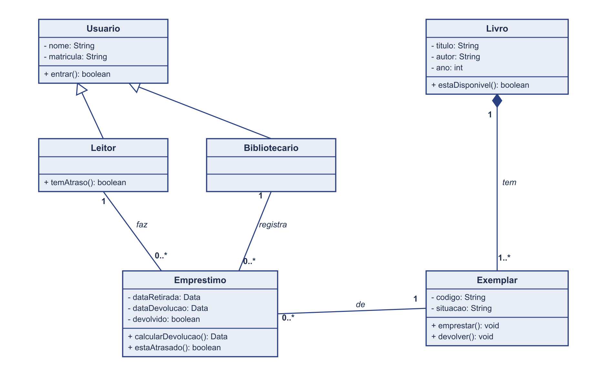
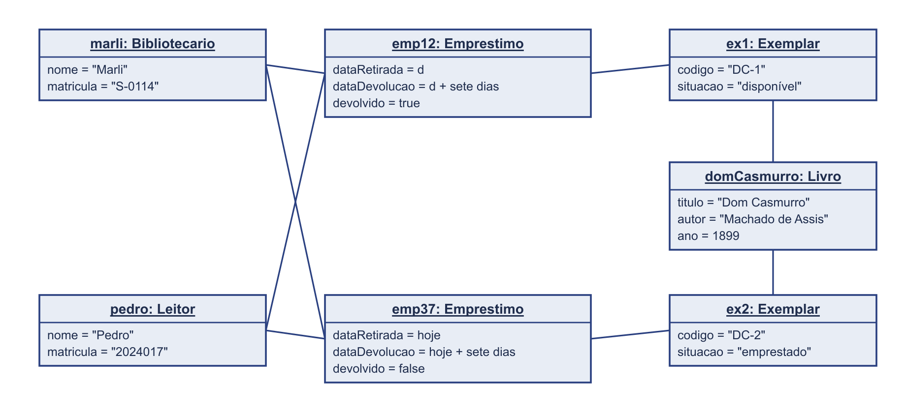

# 4.2.3 Modelagem de Classes

## Dos substantivos às classes

As classes saem dos substantivos. A fonte principal é o fluxo de Registrar empréstimo, especificado na 4.2.2. Cada coisa que o ator informa ou que o sistema confirma é uma coisa que o sistema precisa lembrar. A segunda fonte é a lista de requisitos da 4.2.1. O que aparece nas duas vira classe com mais confiança.

Nem todo substantivo vira classe. Três filtros: o que é detalhe de outra coisa vira atributo (a data de devolução é do empréstimo). O que é interface não entra (tela, botão, relatório). O que está fora do sistema também não (o caderninho, o balcão).

| Substantivo | De onde veio | Vira | Por quê |
|---|---|---|---|
| leitor | passo 1 do fluxo, HU01, RF02 | classe **Leitor** | o sistema guarda quem ele é e sabe se ele tem atraso |
| bibliotecário | ator da 4.2.2, passo 1, RNF02 | classe **Bibliotecario** | o sistema precisa saber quem registrou cada empréstimo e quem pode alterar o acervo |
| nome, matrícula | passo 1 ("pelo nome ou pela matrícula") | atributos de **Usuario** | leitor e bibliotecário têm os dois, e os dois entram no sistema. O que é comum sobe para uma classe geral |
| livro | passo 3, RF01, RF03 | classe **Livro** | o título do acervo: o que a Dona Marli cadastra e o que o leitor consulta |
| exemplar | passo 4 ("o exemplar está disponível"), exceção E2, e a 4.1 ("quem está com cada exemplar") | classe **Exemplar** | a biblioteca tem dois exemplares de Dom Casmurro. O que sai no empréstimo é um deles, não o título. Esta classe não estava na lista de requisitos: nasceu da especificação |
| empréstimo | passo 7, RF05, RF06 | classe **Emprestimo** | é o registro que tira o caderninho de cena: quem, qual exemplar, de quando até quando |
| data de devolução | passo 5, RF07 | atributo de **Emprestimo** | é um detalhe do empréstimo, não uma coisa que existe sozinha |
| caderninho, balcão | falas da 4.2.1 | nada | estão fora do sistema. O caderninho é o que o sistema substitui |

## Classes

Seis classes, no teto. Três faixas em cada uma: o nome no singular com inicial maiúscula, os atributos no formato `nome: tipo`, e as operações com parênteses. Cada atributo e cada operação têm uma origem na coluna da direita, e é ela que a rastreabilidade confere no fim.

Duas coisas mudaram em relação ao diagrama da Aula 19. `Leitor` perdeu o `limiteEmprestimos`, porque nenhum requisito fala de limite: atributo sem requisito é invenção. E `Emprestimo` passou a se ligar a `Exemplar`, não a `Livro`: o que sai da estante é um exemplar, e a exceção E2 fala exatamente disso.

| Classe | Atributos | Operações | Veio de |
|---|---|---|---|
| **Usuario** | - nome: String, - matricula: String | + entrar(): boolean | passo 1 (nome ou matrícula), RNF02 (identificado no sistema) |
| **Leitor** | _herda de Usuario_ | + temAtraso(): boolean | passo 2 e exceção E1 ("não tem empréstimo atrasado") |
| **Bibliotecario** | _herda de Usuario_ | _nenhuma própria_ | RNF02: só quem é bibliotecário altera o acervo, e é ele quem registra |
| **Livro** | - titulo: String, - autor: String, - ano: int | + estaDisponivel(): boolean | RF01 (o que se cadastra), RF03 e passo 4 (a consulta) |
| **Exemplar** | - codigo: String, - situacao: String | + emprestar(): void, + devolver(): void | passo 7 ("marca o exemplar como emprestado"), RF04, exceção E2 |
| **Emprestimo** | - dataRetirada: Data, - dataDevolucao: Data, - devolvido: boolean | + calcularDevolucao(): Data, + estaAtrasado(): boolean | passo 5 e RF07 (a data), RF06 (o atraso), RF04 (a devolução) |

## Diagrama de classes

**Figura 2 – Diagrama de classes do BiblioTech**

Fonte: Autoria própria (2026).

A Figura 2 tem três tipos de linha. As **associações** são as linhas contínuas com um verbo e um número em cada ponta. Um `Leitor` faz zero ou vários `Emprestimo`. Um `Bibliotecario` registra zero ou vários `Emprestimo`. Cada `Emprestimo` é de exatamente um `Exemplar`. O número fica colado na classe que ele conta.

A **herança** é o triângulo vazado apontando para `Usuario`. `Leitor` e `Bibliotecario` são tipos de usuário. Por isso nome, matrícula e a entrada no sistema moram uma vez só, na classe geral. Linha de herança não leva número.

A **composição** é o losango cheio do lado de `Livro`: um exemplar é parte de um título. O teste que decidiu o losango: se a Dona Marli apagar Dom Casmurro do acervo, os dois exemplares dele somem do sistema. Um exemplar sem título não é nada. Morreu junto, então é composição. A multiplicidade `1..*` diz que todo título cadastrado tem pelo menos um exemplar. ❓ A confirmar com a cliente: quando o único exemplar de um título some, ele continua no acervo?

Não há **agregação**. Agregação é parte que sobrevive ao todo apagado, e nada no escopo da 4.1 é assim. O losango não entra para enfeitar.

## Teste de objetos

Um diagrama de classes é uma promessa sobre o mundo. O jeito de testar a promessa é pegar uma situação real do cliente e desenhar os objetos dela. Uma caixa por coisa concreta, com os valores dentro, e uma linha por ligação que existe de fato.

A situação: o Pedro levou o segundo exemplar de Dom Casmurro, a Dona Marli registrou, e ele já tinha devolvido o primeiro exemplar semanas antes.

**Figura 3 – Diagrama de objetos: uma linha do caderninho da Dona Marli**

Fonte: Autoria própria (2026).

| Objeto | Classe | Valores |
|---|---|---|
| `marli` | Bibliotecario | nome = "Marli", matricula = "S-0114" |
| `pedro` | Leitor | nome = "Pedro", matricula = "2024017" |
| `domCasmurro` | Livro | titulo = "Dom Casmurro", autor = "Machado de Assis", ano = 1899 |
| `ex1` | Exemplar | codigo = "DC-1", situacao = "disponível" |
| `ex2` | Exemplar | codigo = "DC-2", situacao = "emprestado" |
| `emp12` | Emprestimo | dataRetirada = d, dataDevolucao = d + sete dias, devolvido = true |
| `emp37` | Emprestimo | dataRetirada = hoje, dataDevolucao = hoje + sete dias, devolvido = false |

**Ligações:** `pedro` e `emp12`, `pedro` e `emp37`, `marli` e `emp12`, `marli` e `emp37`, `emp12` e `ex1`, `emp37` e `ex2`, `domCasmurro` e `ex1`, `domCasmurro` e `ex2`.

**O que o teste confirma**

- **Um leitor faz vários empréstimos.** O pedro aparece ligado a dois `Emprestimo`. Se eu tivesse escrito `1` do lado de `Emprestimo`, este desenho derrubaria a classe.
- **Cada empréstimo é de um leitor e foi registrado por um bibliotecário.** Os dois empréstimos têm uma linha para o pedro e uma para a marli, nunca duas.
- **Um título tem mais de um exemplar, e cada exemplar é de um título.** Dom Casmurro tem o ex1 e o ex2. É isso que separa `Livro` de `Exemplar`: sem a classe nova, o sistema não saberia que o ex1 está na estante enquanto o ex2 está emprestado.
- **Um exemplar passa por vários empréstimos, um de cada vez.** O ex1 está em um empréstimo devolvido, o ex2 em um aberto. A regra "um de cada vez" não cabe na multiplicidade: ela mora na exceção E2 da 4.2.2.

O teste confirmou as quatro linhas. Quando ele derruba uma, o conserto é na classe, não no objeto: o objeto é o mundo, a classe é a promessa.

## Rastreabilidade com a 4.2.2

| Operação ou atributo | Classe | De onde veio |
|---|---|---|
| entrar() | Usuario | RNF02: só usuário identificado altera o acervo |
| temAtraso() | Leitor | passo 2 e E1 de Registrar empréstimo |
| estaDisponivel() | Livro | passo 4 e RF03 Consultar disponibilidade |
| emprestar(), devolver() | Exemplar | passo 7 ("marca o exemplar como emprestado") e RF04 Registrar devolução |
| calcularDevolucao() | Emprestimo | passo 5 e RF07 Calcular data de devolução |
| estaAtrasado() | Emprestimo | RF06 Listar atrasados, e a E1 |
| dataRetirada, dataDevolucao | Emprestimo | passos 5 e 7, e o escopo da 4.1 ("registra até quando") |

**Toda operação tem origem.** Nenhuma operação apareceu sem um passo do fluxo ou um requisito por trás. Se aparecesse, seria sinal de requisito faltando na 4.2.1, e o conserto seria lá.

**Todo passo do sistema tem casa.** Os passos 2, 4, 5 e 7 do fluxo principal, os que o sistema executa, caíram cada um numa operação de uma classe. É assim que a 4.2.4 vai desenhar a sequência: os participantes são estas classes.

**O que a modelagem mudou.** A classe `Exemplar` não estava na 4.2.1 nem no diagrama da Aula 19. Ela nasceu de um substantivo do fluxo, e trouxe a dúvida do `1..*` para a lista do ❓. E `Leitor` ficou mais magro: o `limiteEmprestimos` saiu porque nenhum requisito o sustenta.
