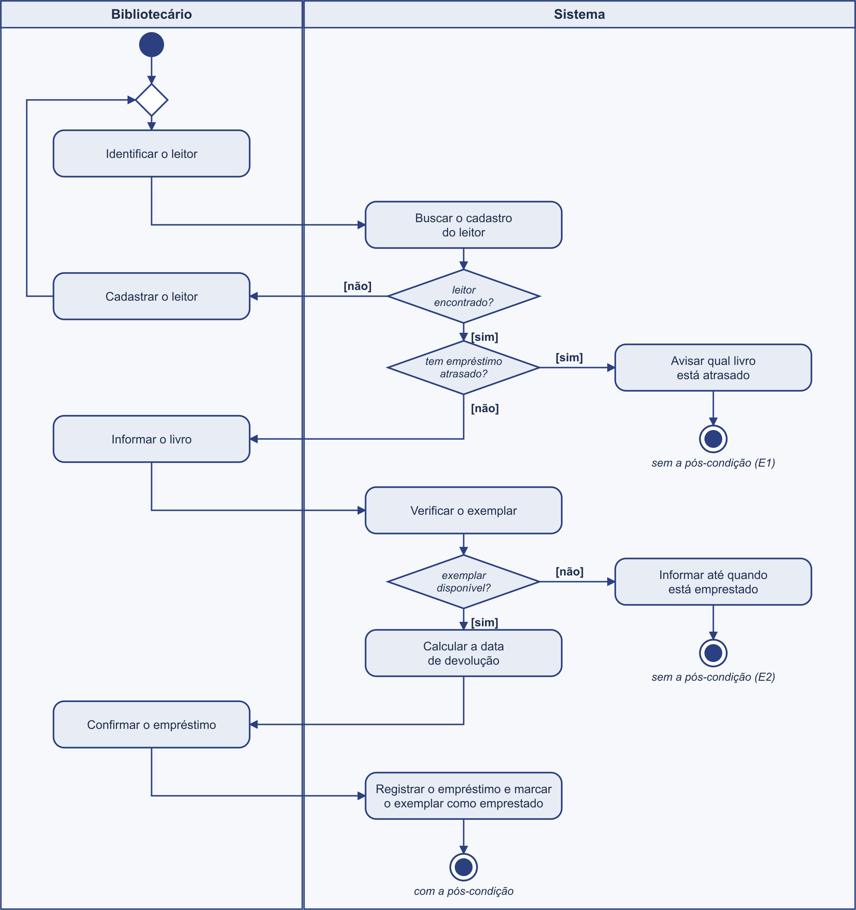

# 4.2.5 Modelagem de Atividade

## Do fluxo ao diagrama

O diagrama de atividades é o fluxo da 4.2.2 desenhado. A fonte é a especificação de Registrar empréstimo: o fluxo principal, o alternativo A1 e as exceções E1 e E2. Nada entra no desenho que não esteja lá.

Três regras de tradução. Cada passo vira uma ação, na raia de quem faz. Cada "o sistema confirma" ou "o sistema verifica" vira uma ação seguida de uma decisão, porque confirmar é perguntar. E cada alternativo ou exceção vira uma saída da decisão: o alternativo volta ao fluxo por uma junção, a exceção termina num fim próprio.

| No fluxo da 4.2.2 | Vira | Raia | Por quê |
|---|---|---|---|
| passo 1: o bibliotecário identifica o leitor | ação **Identificar o leitor** | Bibliotecário | quem age é o ator, e a ação fica na raia dele |
| passo 2: o sistema mostra o cadastro e confirma que não há atraso | ação **Buscar o cadastro do leitor**, e **duas decisões**: _leitor encontrado?_ e _tem empréstimo atrasado?_ | Sistema | um passo com duas conferências esconde duas perguntas. O A1 sai da primeira, a E1 sai da segunda |
| A1: o sistema não encontra o leitor, o bibliotecário o cadastra e volta ao passo 1 | saída [não] da primeira decisão, ação **Cadastrar o leitor** e uma **junção** antes de Identificar o leitor | Bibliotecário | alternativo é desvio que volta. A junção é o ponto em que o caminho novo encontra o caminho principal |
| E1: o leitor tem atraso, o sistema avisa e não registra | saída [sim] da segunda decisão, ação **Avisar qual livro está atrasado** e um **fim** próprio | Sistema | exceção não volta. O caso termina sem a pós-condição, e o fim diz isso |
| passo 3: o bibliotecário informa o livro | ação **Informar o livro** | Bibliotecário | ação do ator |
| passo 4: o sistema confirma que o exemplar está disponível | ação **Verificar o exemplar** e decisão _exemplar disponível?_ | Sistema | confirmar é perguntar. A E2 sai do [não] |
| E2: o exemplar está emprestado, o sistema informa até quando | saída [não], ação **Informar até quando está emprestado** e um **fim** próprio | Sistema | segunda exceção, segundo fim sem a pós-condição |
| passo 5: o sistema calcula a data de devolução (RF07) | ação **Calcular a data de devolução** | Sistema | o requisito que não virou elipse na 4.2.2 vira ação aqui |
| passo 6: o bibliotecário confirma o empréstimo | ação **Confirmar o empréstimo** | Bibliotecário | ação do ator |
| passo 7: o sistema registra e marca o exemplar como emprestado | ação **Registrar o empréstimo e marcar o exemplar como emprestado**, e o **fim** do caminho feliz | Sistema | o passo que entrega a pós-condição. É o único fim com ela |

## Diagrama de atividades

**Figura 4 – Diagrama de atividades de Registrar empréstimo**

Fonte: Autoria própria (2026).

A Figura 4 tem duas raias. A da esquerda é do **Bibliotecário**, a da direita é do **Sistema**. Cada ação está na raia de quem a faz, e as setas cruzam de uma raia para a outra toda vez que a vez passa de um para o outro. Lendo de cima para baixo, o desenho é a conversa de balcão da 4.2.2.

O círculo cheio no alto é o **início**. Logo abaixo dele há uma **junção**, o losango sem pergunta: é por ali que o caminho do A1 volta, depois de cadastrar o leitor. As três **decisões** são os losangos com pergunta, e cada uma tem duas saídas com a guarda entre colchetes: [sim] e [não].

Há três **fins**. O de baixo, na raia do Sistema, é o único em que a pós-condição acontece: o empréstimo registrado e o exemplar marcado. Os dois da direita são os fins da E1 e da E2, e cada um diz o que ficou sem acontecer. Um caso de uso que pode terminar de três jeitos tem três fins. Juntar tudo num fim só esconderia isso.

Não há barra de sincronização (as duas barras grossas que separam e juntam caminhos paralelos). Nada em Registrar empréstimo acontece ao mesmo tempo: é uma conversa, uma coisa depois da outra. O símbolo não entra para enfeitar.

## Rastreabilidade com a 4.2.2

| Elemento do diagrama | Vem de | Confere |
|---|---|---|
| Identificar o leitor, Informar o livro, Confirmar o empréstimo | passos 1, 3 e 6 (o bibliotecário) | três ações na raia do ator, uma por passo |
| Buscar o cadastro do leitor, Verificar o exemplar, Calcular a data de devolução, Registrar o empréstimo e marcar o exemplar como emprestado | passos 2, 4, 5 e 7 (o sistema) | quatro ações na raia do sistema. São as mesmas que a 4.2.3 transformou em operações: temAtraso(), estaDisponivel(), calcularDevolucao(), emprestar() |
| leitor encontrado? [não] | A1 (no passo 2) | volta por junção, como alternativo |
| tem empréstimo atrasado? [sim] | E1 (no passo 2) | termina em fim próprio, como exceção |
| exemplar disponível? [não] | E2 (no passo 4) | termina em fim próprio, como exceção |
| fim com a pós-condição | pós-condição da 4.2.2 | só o caminho feliz chega nele |

**Todo passo tem elemento.** Os sete passos, o A1, a E1 e a E2 estão no desenho, e nenhum elemento do desenho veio de fora da especificação. Se uma ação aparecesse sem passo, o conserto seria na 4.2.2, não aqui.

**Toda decisão tem as duas saídas.** Cada losango com pergunta tem um [sim] e um [não], e cada saída leva a um lugar da especificação: o fluxo principal, o A1, a E1 ou a E2.

**O que o desenho mudou.** O passo 2 da 4.2.2 diz "mostra o cadastro e confirma que não há atraso" numa frase só. Desenhar mostrou que são duas perguntas, e que o A1 e a E1 saem de perguntas diferentes. A especificação continua certa, mas o passo 2 ganhou uma nota ❓ para a próxima revisão: dividir em dois passos deixaria o texto tão claro quanto o desenho.
